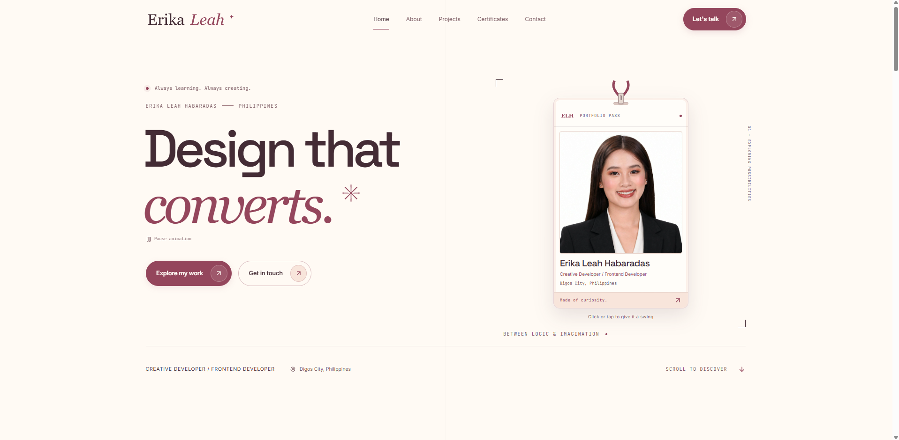
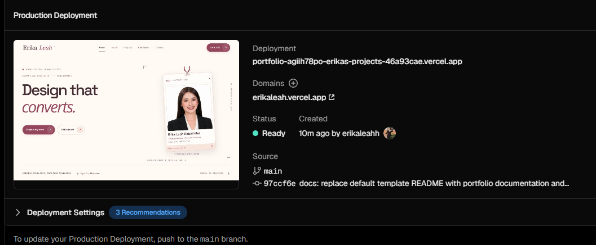
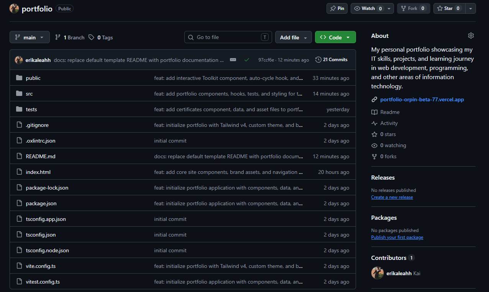

# Portfolio

A personal developer portfolio by Erika Leah Habaradas, a creative frontend developer based in Digos City, Philippines. It brings together storefront design, frontend prototyping, project contributions, and earned certificates in a responsive Peach & Burgundy design.

**Website:** [erikaleah.vercel.app](https://erikaleah.vercel.app/)



## Features

- Responsive navigation with section links and active-section indicators.
- Animated hero with rotating headlines and an interactive portrait lanyard.
- About section with a beauty-inspired contribution display and an opening toolkit compact.
- Featured projects with screenshots, contribution roles, technologies, source links, and live demos.
- Certificate previews with links to the original PDFs.
- CV viewing and download, email contact, GitHub, and LinkedIn links.
- GSAP entrances and scroll animations with reduced-motion support and animation cleanup.
- Keyboard-accessible controls, visible focus states, semantic HTML, and optimized images.
- React Router home route and a custom 404 page.

## Technology stack

| Purpose | Tools |
| --- | --- |
| Application | React, TypeScript, Vite |
| Routing | React Router |
| Styling | Tailwind CSS, CSS |
| Animation | GSAP, ScrollTrigger, `@gsap/react` |
| Icons | Lucide React, SVG brand assets |
| Testing | Vitest, Testing Library, jsdom, axe-core |
| Linting | Oxlint |

## Requirements

- Node.js 24.x
- npm
- Git

## Installation and local development

```bash
git clone https://github.com/erikaleahh/portfolio.git
cd portfolio
npm install
npm run dev
```

Open the local URL printed in the terminal. Vite normally uses `http://localhost:5173` and selects another port if it is already occupied.

No environment variables or backend service are required. The contact action opens the visitor's email application with a `mailto:` link.

## Available commands

| Command | Description |
| --- | --- |
| `npm run dev` | Start the development server. |
| `npm run build` | Check TypeScript and generate the production build. |
| `npm run preview` | Serve the production build locally. |
| `npm run lint` | Run Oxlint. |
| `npm test` | Run the test suite once. |
| `npm run test:watch` | Run tests in watch mode. |

## Editing content

Portfolio content is kept separate from the presentation components.

| Location | Content |
| --- | --- |
| `src/data/portfolio.ts` | Name, role, biography, location, contact links, CV, skills, and tool descriptions. |
| `src/data/projects.ts` | Project details, roles, technologies, screenshots, source visibility, and live demo URLs. |
| `src/data/certificates.ts` | Certificate titles, issuers, dates, previews, PDF paths, and optional verification links. |
| `src/data/site.ts` | Section headings, interface copy, branding paths, and toolkit timing. |
| `src/index.css` | Theme colors, typography, layouts, and responsive styles. |
| `public/` | Images, certificate PDFs, the CV, SVG logos, and the favicon. |

Files inside `public/` use root-relative URLs. For example, `public/documents/cv.pdf` is referenced as `/documents/cv.pdf`.

To replace the CV, add the new PDF under `public/documents/` and update the `cv` URL and download filename in `src/data/portfolio.ts`. Private project repositories remain labeled as private without exposing a source link.

## Production build

```bash
npm run build
npm run preview
```

The production files are generated in `dist/`. Preview serves that build locally; it does not publish the website.

## Deployment

### Vercel

Production deployment for [erikaleah.vercel.app](https://erikaleah.vercel.app/):



Import the GitHub repository into Vercel using these settings:

- Framework preset: **Vite**
- Install command: `npm install`
- Build command: `npm run build`
- Output directory: `dist`
- Node.js version: **24.x**

This is a client-rendered React Router application. For direct navigation and refresh on non-root paths, add a `vercel.json` file in the project root with the SPA fallback below:

```json
{
  "rewrites": [
    { "source": "/(.*)", "destination": "/index.html" }
  ]
}
```

The fallback configuration is shown here for setup; a `vercel.json` file is not currently included in this repository. See [Vercel's Vite SPA documentation](https://vercel.com/docs/frameworks/frontend/vite#using-vite-to-make-spas).

After deploying, check the home page, section navigation, a non-root URL and its refresh behavior, project links, certificate PDFs, and the CV.

### Netlify

Use `npm run build` as the build command and `dist` as the publish directory. Add a `public/_redirects` file containing the following SPA fallback before building:

```text
/* /index.html 200
```

The `_redirects` file is not currently included in this repository. See [Netlify's SPA routing documentation](https://docs.netlify.com/manage/routing/redirects/rewrites-proxies/#history-pushstate-and-single-page-apps).

## Repository

Source code: [erikaleahh/portfolio](https://github.com/erikaleahh/portfolio).



## Screenshots

Documentation screenshots are stored in `docs/images/`. To refresh the website preview, run the development server and capture the home page after fonts and images have loaded. Desktop and mobile views can be added using descriptive filenames.

Project screenshots used by the site are stored in `public/images/projects/`.
